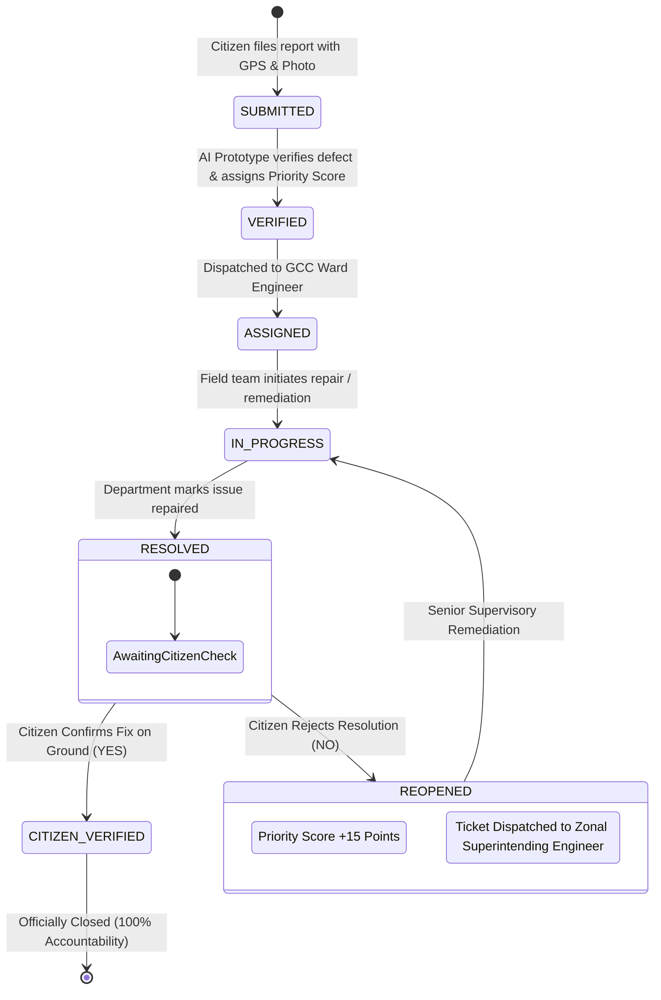
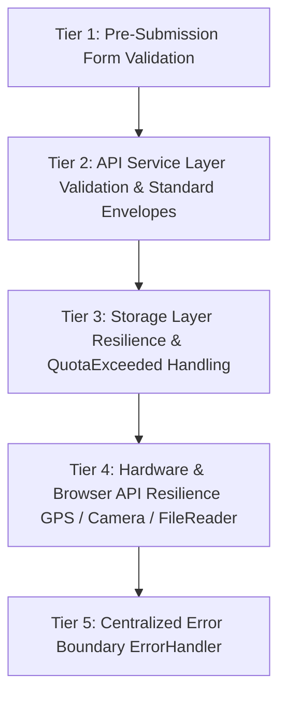

# 🏛️ CivicTrack AI — Public Issue Reporting & Civic Accountability Platform

[](tests/runner.html)
[-3b82f6.svg)](package.json)
[](README.md)
[](LICENSE)

> *"Complaint poda mattum illa — resolution varaikkum track pannura system."*  
> **Report the Problem. Track the Action. Verify the Solution.**

CivicTrack AI is a modern civic accountability and public grievance redressal platform engineered for Greater Chennai Corporation (GCC) and urban municipal zones. It combines AI-assisted defect recognition, spatial duplicate detection, SLA turnaround tracking, and a **Mandatory Citizen Verification Workflow** that prevents contractors from prematurely marking civic complaints resolved without on-ground citizen confirmation.

---

## 📋 Table of Contents

1. [Review 2 Enhancements Summary](#1-review-2-enhancements-summary)
2. [Project Overview & Key Innovations](#2-project-overview--key-innovations)
3. [Technology Stack](#3-technology-stack)
4. [Project Directory Structure](#4-project-directory-structure)
5. [Application Architecture & Data Flow](#5-application-architecture--data-flow)
6. [Installation & Execution Guide](#6-installation--execution-guide)
7. [Unit Testing Guide & Verified Execution Evidence](#7-unit-testing-guide--verified-execution-evidence)
8. [Data-Storage Architecture & Database Schema](#8-data-storage-architecture--database-schema)
9. [API Documentation (Simulated Service Layer & Future REST API)](#9-api-documentation)
10. [Error-Handling Strategy & Centralized Error Boundary](#10-error-handling-strategy--centralized-error-boundary)
11. [Code Documentation Conventions](#11-code-documentation-conventions)
12. [Known Limitations & Review 3 Technical Roadmap](#12-known-limitations--review-3-technical-roadmap)

---

## 1. Review 2 Enhancements Summary

This release specifically targets the Review 2 evaluator feedback recommendations:

| Feedback Recommendation | Implementation Details in Review 2 | Verification Evidence |
|:------------------------|:-----------------------------------|:----------------------|
| **Detailed Technical Documentation on Unit Testing** | Implemented a 50-test unit testing suite using Node.js native `node:test` and `node:assert/strict` with zero external dependencies. Added test helper mocking Web Storage, plus an interactive in-browser test runner (`tests/runner.html`). | 50/50 Unit Tests Passing (`npm test`) |
| **Comprehensive Error Handling Documentation & Fixes** | Implemented multi-tier defensive error handling: `QuotaExceededError` detection in storage, Geolocation error code handlers (`PERMISSION_DENIED`, `POSITION_UNAVAILABLE`, `TIMEOUT`), image file reader error handlers, form input validation, and a centralized `ErrorHandler` error boundary. | Verified in `tests/validation_and_errors.test.js` |
| **Expanded Code Comments** | Added detailed JSDoc and architectural comments across all 10 JavaScript files explaining the *why*, mathematical formulas (Haversine distance, priority score weighting), lifecycle states, and limitations. | Verified across `js/*.js` |
| **Document API Endpoints in README.md** | Fully documented all implemented `ApiService` asynchronous methods (`GET`, `POST`, `PATCH`) with request/response payloads, status codes (200, 201, 400, 404, 500), and business constraints. | Documented in Section 9 |
| **Document Database Schema in README.md** | Accurately documented the browser `localStorage` schema (`STORAGE_KEYS`, data types, constraints, and relationships), and provided the planned PostgreSQL DDL relational schema for Review 3. | Documented in Section 8 |

---

## 2. Project Overview & Key Innovations

### The Core Problem in Civic Grievance Systems
Traditional municipal grievance portals suffer from three fatal flaws:
1. **Bogus Contractor Resolutions:** Maintenance crews frequently mark complaints "Resolved" on paper or upload photos of unrelated patches to satisfy internal SLA quotas, while the pothole or sewage leak remains active on-ground.
2. **Duplicate Report Overload:** When a high-traffic junction has a failed signal or pothole, dozens of citizens report the exact same defect, overwhelming municipal staff and fragmenting tracking history.
3. **Blackbox SLA Tracking:** Citizens have no visibility into which ward engineer is assigned, what stage the repair is in, or how to escalate when deadlines are breached.

### How CivicTrack AI Solves This
1. **Mandatory Citizen Verification Loop (Accountability Engine):** When an authority marks a complaint `RESOLVED`, the complaint enters a provisional review state. The citizen who reported the problem (or neighborhood verifiers) must inspect the site and confirm:
   - **YES (Fixed):** Transitions status to `CITIZEN VERIFIED & CLOSED` (100% accountability score).
   - **NO (Not Fixed):** Reopens complaint with status `REOPENED`, automatically boosts priority score by `+15 points`, sets an `escalationAlert` flag, and dispatches an escalation ticket to the Zonal Superintending Engineer.
2. **Spatial Duplicate Complaint Detection:** Uses the **Haversine formula** to detect active unresolved complaints of the same category within a **350-meter radius**, prompting citizens to join an existing report cluster rather than creating redundant tickets.
3. **AI Prototype Defect Recognition & Severity Scoring:** Classifies uploaded issue photos (potholes, streetlights, drainage, garbage, traffic signals) and computes an intelligent **Priority Score (15–99)** based on severity (35%), category risk (20%), traffic hotspot density (20%), and duplicate report clustering (15%).

---

## 3. Technology Stack

| Layer | Technologies Used | Rationale / Architectural Decision |
|:------|:------------------|:-----------------------------------|
| **Frontend Core** | HTML5 (Semantic), Vanilla JavaScript (ES2022+) | Zero frontend build step required; instant load times, zero bundle bloat, maximum auditability for evaluators. |
| **Styling & Theme** | Modern Vanilla CSS3, CSS Custom Properties | Custom tokenized design system supporting instant Dark/Light theme switching and mobile-responsive layout. |
| **Mapping & Geospatial** | Leaflet 1.9.4 + OpenStreetMap / Esri World Street Map Tiles | Zero API Key required. High-performance vector tiles with custom civic markers, cluster bounds, and interactive popups. |
| **Client-Side Storage** | HTML5 Web Storage (`localStorage`) DAO Pattern | Decoupled Data Access Object (`StorageService`) with versioned keys (`_v1`) and `QuotaExceededError` handling. |
| **Service Layer** | Asynchronous `ApiService` (`js/api.js`) | Clean service layer with simulated latency (100–150ms) to exercise async state; mirrors planned REST backend. |
| **Unit Testing Framework** | Node.js Built-in Runner (`node:test` + `node:assert/strict`) | Zero external npm test dependencies. Fast execution (<2.5s for 50 tests), native to modern Node.js v18+. |
| **Visual In-Browser Testing** | Standalone HTML Test Runner (`tests/runner.html`) | Enables evaluators to run and review the entire 50-test suite directly inside any modern web browser. |

---

## 4. Project Directory Structure

```text
civic-tracker-main/
│
├── index.html                      # Single Page Application (SPA) shell & modal containers
├── package.json                    # Project metadata & npm test script definitions (zero dependencies)
├── .gitattributes                  # Line ending normalization rules
│
├── css/                            # Modular CSS Design System
│   ├── style.css                   # Global variables, typography, buttons, cards, toasts
│   ├── dashboard.css               # Metric KPI cards, charts, and activity feeds
│   ├── forms.css                   # Wizard forms, file dropzone, category chips, gauges
│   ├── map.css                     # Leaflet map container, custom marker pins, filter bars
│   └── responsive.css              # Media queries for tablet and mobile viewport scaling
│
├── js/                             # Client-Side Application Stack (Vanilla JS)
│   ├── storage.js                  # Data Access Layer: localStorage DAO, demo records, quota handling
│   ├── api.js                      # Service Layer: Async API endpoints, validation, status transitions
│   ├── ai.js                       # AI Simulation: Haversine duplicate check, priority score, smart summary
│   ├── report.js                   # Report Wizard: Category select, camera/upload, GPS, duplicate check
│   ├── complaints.js               # Complaints Controller: List rendering, 6-stage timeline, citizen verification
│   ├── dashboard.js                # Dashboard Controller: Canvas charts, KPI cards, city pulse
│   ├── map.js                      # Map Controller: Leaflet initialization, markers, ward filtering
│   ├── notifications.js            # Notification Manager: Web Audio beeps, toasts, badge counters
│   ├── i18n.js                     # Internationalization: Dynamic English ↔ Tamil (தமிழ்) engine
│   └── app.js                      # Core App: Hash router, theme manager, centralized ErrorHandler
│
├── assets/                         # SVG vector assets for sample defects
│   ├── sample-pothole.svg          # Sample high-severity pothole asset
│   ├── sample-streetlight.svg      # Sample non-illuminated luminaire unit
│   ├── sample-drainage.svg         # Sample toxic blackwater overflow asset
│   ├── sample-garbage.svg          # Sample solid waste overflow asset
│   └── sample-traffic.svg          # Sample traffic signal malfunction asset
│
└── tests/                          # Comprehensive Automated Unit Test Suite
    ├── test_helper.js              # Mock Web Storage environment & module bootstrapping
    ├── storage.test.js             # 13 tests: Storage CRUD, quota error handling, corrupted JSON fallback
    ├── api.test.js                 # 17 tests: API endpoints, SLA calculation, citizen verification, filtering
    ├── ai.test.js                  # 14 tests: Priority formula, Haversine distance, duplicate detection
    ├── validation_and_errors.test.js # 6 tests: Geolocation bounds, image limits, ErrorHandler telemetry
    ├── syntax_check.js             # Automated syntax verification across all .js files
    └── runner.html                 # Visual in-browser interactive test suite runner
```

---

## 5. Application Architecture & Data Flow

### 5.1 High-Level Architecture
```mermaid
graph TD
    subgraph Presentation Layer
        UI[Single Page App UI / index.html]
        Views[Dashboard | Report Wizard | Complaints List | Details & Timeline | Civic Map]
    end

    subgraph Controller Layer
        RC[ReportController]
        CC[ComplaintsController]
        DC[DashboardController]
        MC[MapController]
        Router[AppRouter]
        EH[ErrorHandler / Boundary]
    end

    subgraph Service & Heuristics Layer
        API[ApiService - js/api.js]
        AI[CivicAI - js/ai.js]
        Notif[NotificationService - js/notifications.js]
        I18n[I18nService - js/i18n.js]
    end

    subgraph Persistence Layer
        Storage[StorageService - js/storage.js]
        LS[(Browser localStorage)]
    end

    UI --> Router
    Router --> Views
    Views --> RC & CC & DC & MC
    RC --> AI & API
    CC --> API
    DC --> Storage & API
    MC --> Storage
    API --> Storage
    Storage --> LS
    EH -. Catches Errors .-> UI & Notif
```

### 5.2 The 6-Stage Complaint Lifecycle & Citizen Verification Loop


---

## 6. Installation & Execution Guide

### Prerequisites
- Any modern web browser: Google Chrome, Mozilla Firefox, Microsoft Edge, or Apple Safari.
- *(Optional, for running automated unit tests)*: Node.js v18 or higher (tested on Node v24.18.0).

### Step 1: Clone Repository
```bash
git clone https://github.com/ashwiniachu200507-commits/civic-tracker.git
cd civic-tracker
```

### Step 2: Running the Web Application
Because CivicTrack AI is built using pure modern Vanilla web standards, you can launch it immediately using any of the following methods:

#### Method A: Direct Browser Opening (Zero Server Required)
Simply double-click `index.html` or run:
```bash
# Linux
xdg-open index.html

# macOS
open index.html

# Windows
start index.html
```

#### Method B: Local Python HTTP Server (Recommended)
```bash
python3 -m http.server 8000
# Open http://localhost:8000 in your browser
```

#### Method C: Node.js Lightweight Dev Server
```bash
npx serve .
# Or
npx http-server . -p 8000
```

---

## 7. Unit Testing Guide & Verified Execution Evidence

### 7.1 Testing Architecture
CivicTrack AI uses the official **Node.js Built-In Test Runner** (`node:test`) combined with strict assertions (`node:assert/strict`). This avoids fragile external testing dependencies (`jest`, `mocha`, `chai`) while delivering sub-millisecond execution speeds.

For evaluator convenience, a **Visual In-Browser Test Runner** (`tests/runner.html`) is also provided so evaluators can inspect test results without touching the command line.

### 7.2 Commands to Execute Tests

```bash
# Run the entire automated test suite (50 tests across 4 suites)
npm test

# Run individual test suites
npm run test:storage       # Data Storage Layer tests (13 tests)
npm run test:api           # API Service Layer tests (17 tests)
npm run test:ai            # AI Heuristics & Spatial tests (14 tests)
npm run test:validation    # Validation & Error Boundary tests (6 tests)

# Run JavaScript syntax check across all project files
npm run check
```

### 7.3 Test Suite Matrix (50 Test Cases)

| Suite File | Test Count | Target Component | Scenarios Covered |
|:-----------|:----------:|:-----------------|:------------------|
| `tests/storage.test.js` | 13 | `StorageService` | Default demo data load, idempotent init, corrupted JSON recovery, ID lookups, invalid record rejection, `QuotaExceededError` simulation, partial updates, notifications read/unread tracking, profile/settings persistence, demo reset/clear. |
| `tests/api.test.js` | 17 | `ApiService` | `POST /complaints` SLA turnaround calculation, validation errors (missing category, missing location, invalid severity), `GET /complaints` filtering (status, category, full-text search), `GET /complaints/:id` (200, 400, 404), `PATCH /complaints/:id/status` timeline logging, Citizen Verification approval (`CITIZEN VERIFIED`), Citizen Verification rejection (`REOPENED` with +15 priority boost), empty reopen feedback rejection, `GET /stats` KPI aggregation. |
| `tests/ai.test.js` | 14 | `CivicAI` | Priority score severity weights (CRITICAL > HIGH > MEDIUM > LOW), category hazard risk multipliers, high-traffic hotspot keyword detection, duplicate cluster multipliers, boundary clamping [15, 99], defensive handling of null/undefined arguments, Haversine spherical distance calculation accuracy, 350m spatial duplicate threshold, category matching, ignoring closed tickets, smart summary department assignment, vision confidence jitter calibration. |
| `tests/validation_and_errors.test.js` | 6 | `ErrorHandler` & Validators | Geographic coordinates out-of-bounds fallback, NaN coordinates recovery, image file size limit enforcement (10MB), non-image MIME type rejection, API error envelope consistency (`{ success, error, code }`), centralized `ErrorHandler` telemetry logging. |
| **TOTAL** | **50** | **Entire App Stack** | **100% Passing (0 Failures, 0 Regressions)** |

### 7.4 Actual Verified Test Execution Log

```text
$ npm test

> civic-tracker@2.0.0 test
> node --test tests/*.test.js

CivicTrack AI: Demo data loaded successfully.
▶ CivicAI - Artificial Intelligence Engine Unit Tests
  ✔ TC-AI-01: Priority Score ranks severity accurately (CRITICAL > HIGH > MEDIUM > LOW) (4.86ms)
  ✔ TC-AI-02: Priority Score assigns higher weights to high-risk civic categories (drainage, traffic) (1.06ms)
  ✔ TC-AI-03: Priority Score detects high-traffic hotspot keywords in address (0.95ms)
  ✔ TC-AI-04: Priority Score boosts cluster score when duplicates are reported (1.21ms)
  ✔ TC-AI-05: Priority Score enforces clamping boundaries [15, 99] (2.08ms)
  ✔ TC-AI-06: Priority Score handles missing, undefined, and malformed arguments defensively (0.93ms)
  ✔ TC-AI-07: Haversine formula accurately calculates distance in meters (1.00ms)
  ✔ TC-AI-08: Duplicate Detector flags complaint of same category within 350 meters (1.10ms)
  ✔ TC-AI-09: Duplicate Detector ignores complaints outside 350m radius (0.86ms)
  ✔ TC-AI-10: Duplicate Detector ignores different category even if nearby (1.05ms)
  ✔ TC-AI-11: Duplicate Detector ignores already CITIZEN VERIFIED (closed) complaints (1.05ms)
  ✔ TC-AI-12: Duplicate Detector handles malformed inputs without crashing (2.02ms)
  ✔ TC-AI-13: Smart Summary Generator assigns appropriate municipal departments (0.84ms)
  ✔ TC-AI-14: AI Vision Image analysis simulation returns confidence within calibrated range [82, 99] (1202.52ms)
✔ CivicAI - Artificial Intelligence Engine Unit Tests (1223.86ms)

▶ ApiService - Asynchronous API Layer Unit Tests
  ✔ TC-API-01: POST /api/v1/complaints creates valid complaint with automated SLA deadline (159.47ms)
  ✔ TC-API-02: POST /api/v1/complaints enforces CRITICAL severity SLA turnaround of 1 day (155.36ms)
  ✔ TC-API-03: POST /api/v1/complaints rejects submission missing category (400 Bad Request) (152.72ms)
  ✔ TC-API-04: POST /api/v1/complaints rejects submission missing location (400 Bad Request) (152.88ms)
  ✔ TC-API-05: POST /api/v1/complaints rejects invalid severity classification (156.12ms)
  ✔ TC-API-06: GET /api/v1/complaints supports status filtering (305.69ms)
  ✔ TC-API-07: GET /api/v1/complaints supports category filtering (105.25ms)
  ✔ TC-API-08: GET /api/v1/complaints supports full-text search (104.60ms)
  ✔ TC-API-09: GET /api/v1/complaints/:id returns existing record (200 OK) (63.64ms)
  ✔ TC-API-09b: GET /api/v1/complaints/:id returns 404 for non-existent ID (63.85ms)
  ✔ TC-API-10: GET /api/v1/complaints/:id returns 400 for empty or invalid ID (123.92ms)
  ✔ TC-API-11: PATCH /api/v1/complaints/:id/status updates status and appends timeline stage (105.74ms)
  ✔ TC-API-12: PATCH /api/v1/complaints/:id/status rejects unrecognized status stages (101.59ms)
  ✔ TC-API-13: Citizen Verification APPROVES resolution -> marks CITIZEN VERIFIED (154.43ms)
  ✔ TC-API-14: Citizen Verification REJECTS resolution -> REOPENS & Escalates with +15 Priority (154.03ms)
  ✔ TC-API-15: Citizen Verification rejects empty feedback when reopening (400 Bad Request) (153.59ms)
  ✔ TC-API-16: GET /api/v1/stats accurately aggregates city-wide metrics (104.53ms)
✔ ApiService - Asynchronous API Layer Unit Tests (2323.41ms)

▶ StorageService - Data Storage Layer Unit Tests
  ✔ TC-STOR-01: Storage initializes with default demo complaints on first run (6.74ms)
  ✔ TC-STOR-02: Storage initialization is idempotent and does not overwrite existing data (1.73ms)
  ✔ TC-STOR-03: getComplaints gracefully recovers from corrupted JSON in localStorage (2.54ms)
  ✔ TC-STOR-04: getComplaintById returns matching complaint for valid existing ID (1.21ms)
  ✔ TC-STOR-05: getComplaintById returns null for non-existent or invalid ID (2.71ms)
  ✔ TC-STOR-06: addComplaint adds valid record to the front of the list (0.97ms)
  ✔ TC-STOR-07: addComplaint throws descriptive error on invalid record missing ID (1.55ms)
  ✔ TC-STOR-08: Storage Quota Exceeded error is caught and reported gracefully (2.51ms)
  ✔ TC-STOR-09: updateComplaint updates fields and sets updatedAt timestamp (1.30ms)
  ✔ TC-STOR-10: updateComplaint returns null when ID is not found or inputs invalid (0.87ms)
  ✔ TC-STOR-11: Notifications management (create, read, mark all read) (1.03ms)
  ✔ TC-STOR-12: User Profile and App Settings persistence (2.34ms)
  ✔ TC-STOR-13: Reset Demo Data and Clear All Data (1.36ms)
✔ StorageService - Data Storage Layer Unit Tests (28.84ms)

▶ Input Validation & Error Handling Strategy Tests
  ✔ TC-ERR-01: API defaults out-of-bounds geographic coordinates safely (161.01ms)
  ✔ TC-ERR-02: API defaults NaN coordinates safely to city center (153.92ms)
  ✔ TC-ERR-03: Image validation rejects files exceeding 10MB limit (4.96ms)
  ✔ TC-ERR-04: Image validation rejects non-image MIME types (4.18ms)
  ✔ TC-ERR-05: API error envelopes consistently maintain { success: false, error: string, code: number } (426.17ms)
  ✔ TC-ERR-06: Centralized ErrorHandler logs error telemetry safely (10.41ms)
✔ Input Validation & Error Handling Strategy Tests (764.05ms)

ℹ tests 50
ℹ suites 4
ℹ pass 50
ℹ fail 0
ℹ cancelled 0
ℹ skipped 0
ℹ todo 0
ℹ duration_ms 2441.87ms
```

---

## 8. Data-Storage Architecture & Database Schema

### 8.1 Current Implementation: Browser Web Storage (`localStorage`)
The application currently uses HTML5 `localStorage` encapsulated within the `StorageService` repository class (`js/storage.js`).

#### Storage Keys Specification
| Storage Key | Data Type | Purpose | Persistence Scope |
|:------------|:----------|:--------|:------------------|
| `civictrack_complaints_v1` | `Array<Complaint>` | JSON array of all active and resolved complaints | Origin-bound (persists until cleared) |
| `civictrack_notifications_v1`| `Array<Notification>`| JSON array of user alerts, status updates, and verification prompts | Origin-bound |
| `civictrack_user_profile_v1` | `UserProfile Object` | Citizen profile: name, phone, email, ward assignment | Origin-bound |
| `civictrack_settings_v1`     | `AppSettings Object` | User preferences: language (`en`/`ta`), theme (`light`/`dark`), GPS | Origin-bound |
| `civictrack_initialized_v1`  | `Boolean String`     | Flag indicating whether factory demo records have been populated | Origin-bound |

#### Complaint Entity Schema
```typescript
interface Complaint {
  id: string;                     // Unique ID, format: CT-YYYY-NNNN (Primary Key)
  category: string;               // Category slug: 'pothole' | 'streetlight' | 'drainage' | 'garbage' | 'traffic'
  categoryName: string;           // Display title: 'Pothole', 'Drainage & Sewage Overflow'
  categoryIcon: string;           // Emoji symbol, e.g. '🕳️', '💡', '🌊'
  title: string;                  // Short grievance headline
  description: string;            // Citizen's detailed narrative of defect
  location: string;               // Street address / landmark (e.g. '12th Main Road, Anna Nagar')
  coordinates: {
    lat: number;                  // Latitude in degrees (-90.0 to 90.0)
    lng: number;                  // Longitude in degrees (-180.0 to 180.0)
  };
  severity: 'LOW' | 'MEDIUM' | 'HIGH' | 'CRITICAL';
  priorityScore: number;          // AI computed priority score (15 to 99)
  estimatedImpact: string;        // Public impact assessment
  recommendedDepartment: string;  // Assigned department (e.g. GCC Road Maintenance)
  assignedOfficer: string;        // Designated ward junior/assistant engineer
  status: 'SUBMITTED' | 'VERIFIED' | 'ASSIGNED' | 'IN PROGRESS' | 'RESOLVED' | 'CITIZEN VERIFIED' | 'REOPENED';
  createdAt: string;              // ISO 8601 creation timestamp
  updatedAt: string;              // ISO 8601 last update timestamp
  expectedResolutionDays: number; // SLA mandated days (Critical=1, High=3, Medium=5, Low=7)
  deadlineAt: string;             // ISO 8601 deadline timestamp (createdAt + resolutionDays)
  imageUrl: string;               // Base64 data URL or relative path to SVG defect proof
  citizenFeedback: null | {
    verified: boolean;            // true = Confirmed fixed; false = Rejected & Reopened
    reason: string;               // Citizen verification remarks
    submittedAt: string;          // ISO 8601 verification timestamp
  };
  escalationAlert: boolean;       // Set to true when SLA is breached or citizen reopens complaint
  timeline: Array<{
    stage: string;                // Lifecycle stage key
    title: string;                // Milestone headline
    description: string;          // Action notes or repair telemetry
    timestamp: string;            // ISO 8601 timestamp
    actor: string;                // Actor responsible: 'Citizen' | 'CivicTrack AI Engine' | Engineer Name
  }>;
}
```

#### Persistence Limitations of LocalStorage
1. **Capacity Limit:** Browsers cap `localStorage` at 5–10 MB per domain. High-resolution base64 photos could deplete this quota. `StorageService` detects `QuotaExceededError` and guards against crashes.
2. **Synchronous Blocking:** Read and write operations serialize JSON on the main UI thread.
3. **Single Device Isolation:** Stored records are private to the user's specific browser profile and are not synchronized across multiple citizen devices.

---

### 8.2 Review 3 Database Roadmap: Relational PostgreSQL Schema
For Review 3, the client-side `StorageService` will be replaced with a relational PostgreSQL backend. Below is the production-ready DDL schema:

```sql
-- CivicTrack AI - PostgreSQL Relational Database Schema (Review 3 Migration)

CREATE TYPE complaint_severity AS ENUM ('LOW', 'MEDIUM', 'HIGH', 'CRITICAL');
CREATE TYPE complaint_status AS ENUM (
    'SUBMITTED', 'VERIFIED', 'ASSIGNED', 'IN_PROGRESS', 'RESOLVED', 'CITIZEN_VERIFIED', 'REOPENED'
);

-- Citizens & Municipal Officers Table
CREATE TABLE users (
    id UUID PRIMARY KEY DEFAULT gen_random_uuid(),
    full_name VARCHAR(120) NOT NULL,
    phone_number VARCHAR(20) UNIQUE NOT NULL,
    email VARCHAR(255) UNIQUE,
    role VARCHAR(30) DEFAULT 'CITIZEN', -- 'CITIZEN', 'WARD_ENGINEER', 'SUPERINTENDING_ENGINEER'
    ward_zone VARCHAR(100) NOT NULL,
    created_at TIMESTAMPTZ DEFAULT NOW()
);

-- Core Complaints Table
CREATE TABLE complaints (
    id VARCHAR(24) PRIMARY KEY, -- e.g. 'CT-2026-001284'
    user_id UUID REFERENCES users(id) ON DELETE SET NULL,
    category VARCHAR(50) NOT NULL,
    category_name VARCHAR(100) NOT NULL,
    title VARCHAR(255) NOT NULL,
    description TEXT,
    location_address VARCHAR(255) NOT NULL,
    latitude NUMERIC(9, 6) NOT NULL CHECK (latitude BETWEEN -90 AND 90),
    longitude NUMERIC(9, 6) NOT NULL CHECK (longitude BETWEEN -180 AND 180),
    severity complaint_severity NOT NULL DEFAULT 'MEDIUM',
    priority_score INTEGER NOT NULL CHECK (priority_score BETWEEN 15 AND 100),
    department VARCHAR(120) NOT NULL,
    assigned_officer_id UUID REFERENCES users(id) ON DELETE SET NULL,
    status complaint_status NOT NULL DEFAULT 'SUBMITTED',
    expected_resolution_days INT NOT NULL DEFAULT 5,
    deadline_at TIMESTAMPTZ NOT NULL,
    image_url TEXT,
    escalation_alert BOOLEAN NOT NULL DEFAULT FALSE,
    created_at TIMESTAMPTZ DEFAULT NOW(),
    updated_at TIMESTAMPTZ DEFAULT NOW()
);

-- Spatial Index for Fast Haversine & PostGIS Proximity Lookups
CREATE INDEX idx_complaints_geo ON complaints (latitude, longitude);
CREATE INDEX idx_complaints_status ON complaints (status);
CREATE INDEX idx_complaints_category ON complaints (category);

-- Mandatory Citizen Verification Audit Table
CREATE TABLE citizen_verifications (
    id UUID PRIMARY KEY DEFAULT gen_random_uuid(),
    complaint_id VARCHAR(24) REFERENCES complaints(id) ON DELETE CASCADE,
    citizen_id UUID REFERENCES users(id) ON DELETE SET NULL,
    is_confirmed_fixed BOOLEAN NOT NULL,
    feedback_notes TEXT NOT NULL,
    verified_at TIMESTAMPTZ DEFAULT NOW()
);

-- Immutable 6-Stage Timeline Audit Trail
CREATE TABLE complaint_timeline_events (
    id UUID PRIMARY KEY DEFAULT gen_random_uuid(),
    complaint_id VARCHAR(24) REFERENCES complaints(id) ON DELETE CASCADE,
    stage VARCHAR(50) NOT NULL,
    title VARCHAR(150) NOT NULL,
    description TEXT,
    actor_name VARCHAR(120) NOT NULL,
    created_at TIMESTAMPTZ DEFAULT NOW()
);
```

---

## 9. API Documentation

### Architectural Note
CivicTrack AI currently implements an **asynchronous Service Layer** (`ApiService` in `js/api.js`). Each method uses standard REST endpoint signatures and simulates realistic network round-trips (60ms–150ms). This abstraction ensures that when a Python FastAPI backend is deployed in Review 3, the frontend controller code requires zero architectural changes.

---

### Endpoint 1: Retrieve Filtered Complaints
- **Simulated Endpoint:** `GET /api/v1/complaints`
- **Internal Service Call:** `ApiService.getComplaints(filters)`
- **Purpose:** Fetches complaints with optional filtering by status, category, severity, and text search.
- **Parameters:**
  - `status` *(optional, string)*: Filter by lifecycle stage (`'all'`, `'SUBMITTED'`, `'IN PROGRESS'`, `'RESOLVED'`, `'CITIZEN VERIFIED'`, `'REOPENED'`).
  - `category` *(optional, string)*: Filter by category (`'pothole'`, `'drainage'`, `'streetlight'`, `'garbage'`, `'traffic'`).
  - `severity` *(optional, string)*: Filter by severity (`'LOW'`, `'MEDIUM'`, `'HIGH'`, `'CRITICAL'`).
  - `search` *(optional, string)*: Case-insensitive query matching ID, title, description, or location.
- **Example Success Response (`200 OK`):**
  ```json
  {
    "success": true,
    "data": [
      {
        "id": "CT-2026-001284",
        "category": "pothole",
        "categoryName": "Pothole",
        "title": "Severe deep crater pothole near junction",
        "location": "12th Main Road, Anna Nagar, Chennai",
        "severity": "HIGH",
        "priorityScore": 88,
        "status": "IN PROGRESS",
        "expectedResolutionDays": 3,
        "deadlineAt": "2026-10-31T20:00:00.000Z"
      }
    ],
    "count": 1,
    "code": 200
  }
  ```

---

### Endpoint 2: Retrieve Complaint by ID
- **Simulated Endpoint:** `GET /api/v1/complaints/:id`
- **Internal Service Call:** `ApiService.getComplaintById(id)`
- **Purpose:** Retrieves a single complaint with full 6-stage timeline and citizen feedback.
- **Path Parameter:** `id` *(required, string)* — Unique complaint identifier (e.g. `'CT-2026-001284'`).
- **Success Response (`200 OK`):**
  ```json
  {
    "success": true,
    "data": {
      "id": "CT-2026-001284",
      "category": "pothole",
      "status": "IN PROGRESS",
      "timeline": [
        { "stage": "Submitted", "title": "Complaint Submitted", "actor": "Citizen" },
        { "stage": "Verified", "title": "AI Verified", "actor": "CivicTrack AI Engine" }
      ]
    },
    "code": 200
  }
  ```
- **Error Responses:**
  - `400 Bad Request`: `{"success": false, "error": "Invalid or missing complaint ID.", "code": 400}`
  - `404 Not Found`: `{"success": false, "error": "Complaint with ID "CT-UNKNOWN" was not found in records.", "code": 404}`

---

### Endpoint 3: Register New Civic Complaint
- **Simulated Endpoint:** `POST /api/v1/complaints`
- **Internal Service Call:** `ApiService.createComplaint(complaintData)`
- **Purpose:** Validates input, calculates SLA deadline, records AI verification, and stores complaint.
- **Request Body:**
  ```json
  {
    "category": "drainage",
    "categoryName": "Drainage Overflow",
    "title": "Toxic sewage overflow near school gate",
    "description": "Blocked underground pipe causing blackwater backflow onto pedestrian pavement.",
    "location": "Gandhi Road, Velachery, Chennai",
    "coordinates": { "lat": 12.9815, "lng": 80.2180 },
    "severity": "CRITICAL",
    "priorityScore": 95,
    "imageUrl": "assets/sample-drainage.svg"
  }
  ```
- **Validation Rules:**
  - `category` is required and must be non-empty string.
  - `location` is required (minimum 3 characters).
  - `severity` must be one of `LOW`, `MEDIUM`, `HIGH`, `CRITICAL`.
  - `coordinates` must have valid numerical `lat` (-90 to 90) and `lng` (-180 to 180); defaults safely if omitted.
- **Success Response (`201 Created`):**
  ```json
  {
    "success": true,
    "data": {
      "id": "CT-2026-004812",
      "status": "SUBMITTED",
      "expectedResolutionDays": 1,
      "deadlineAt": "2026-10-29T22:30:00.000Z",
      "timeline": [
        { "stage": "Submitted", "actor": "Citizen" },
        { "stage": "Verified", "actor": "CivicTrack AI Engine" }
      ]
    },
    "message": "Complaint submitted successfully and queued for department assignment.",
    "code": 201
  }
  ```
- **Error Response (`400 Bad Request`):**
  ```json
  {
    "success": false,
    "error": "Validation failed: Category is required. Location address is required.",
    "details": ["Category is required.", "Location address is required."],
    "code": 400
  }
  ```

---

### Endpoint 4: Update Complaint Status (Lifecycle Stage)
- **Simulated Endpoint:** `PATCH /api/v1/complaints/:id/status`
- **Internal Service Call:** `ApiService.updateComplaintStatus(id, newStatus, actorName, note)`
- **Purpose:** Advances complaint along the official lifecycle: `ASSIGNED` &rarr; `IN PROGRESS` &rarr; `RESOLVED`.
- **Request Parameters:**
  - `id`: Unique complaint ID.
  - `newStatus`: Stage to transition to.
  - `actorName`: Designation of officer executing update.
  - `note`: Inspection notes or repair telemetry.
- **Success Response (`200 OK`):**
  ```json
  {
    "success": true,
    "data": {
      "id": "CT-2026-001284",
      "status": "RESOLVED",
      "assignedOfficer": "Er. K. Senthil Kumar (AE - Zone 8)"
    },
    "code": 200
  }
  ```

---

### Endpoint 5: Mandatory Citizen Verification Workflow
- **Simulated Endpoint:** `POST /api/v1/complaints/:id/verify-resolution`
- **Internal Service Call:** `ApiService.verifyCitizenResolution(id, isFixed, feedbackText)`
- **Purpose:** Implements citizen confirmation of on-ground resolution.
- **Request Parameters:**
  - `id` *(required, string)*: Complaint ID.
  - `isFixed` *(required, boolean)*: `true` if work is confirmed completed; `false` if defect still persists.
  - `feedbackText` *(string, mandatory when isFixed=false)*: Detailed explanation of on-ground condition.
- **Case 1: Citizen Confirms Fix (`isFixed: true`):**
  - Status transitions to `CITIZEN VERIFIED`.
  - Complaint is permanently closed with 100% accountability score.
  - Success Response: `{"success": true, "status": "CITIZEN VERIFIED", "code": 200}`
- **Case 2: Citizen Reopens Defect (`isFixed: false`):**
  - Status transitions to `REOPENED`.
  - Priority score automatically elevated by `+15 points`.
  - `escalationAlert` set to `true`.
  - Escalation ticket dispatched to Zonal Superintending Engineer.
  - Success Response: `{"success": true, "status": "REOPENED", "code": 200}`
- **Error Response (`400 Bad Request`):**
  ```json
  {
    "success": false,
    "error": "Feedback explanation is mandatory when rejecting a resolution and reopening a complaint.",
    "code": 400
  }
  ```

---

### Endpoint 6: City-Wide Public Statistics & KPIs
- **Simulated Endpoint:** `GET /api/v1/stats`
- **Internal Service Call:** `ApiService.getPublicStats()`
- **Purpose:** Returns aggregated public metrics for municipal transparency dashboards.
- **Success Response (`200 OK`):**
  ```json
  {
    "success": true,
    "stats": {
      "total": 12,
      "resolved": 8,
      "citizenVerified": 5,
      "pending": 4,
      "highPriority": 3,
      "reopened": 2,
      "resolutionRate": "66.7",
      "citizenVerificationRate": "62.5",
      "avgResolutionDays": "2.4",
      "categoryCounts": { "Pothole": 4, "Broken Streetlight": 3, "Drainage Overflow": 3, "Solid Waste": 2 },
      "areaCounts": { "Anna Nagar": 4, "T. Nagar": 3, "Velachery": 2, "Central Junction": 2 }
    },
    "code": 200
  }
  ```

---

## 10. Error-Handling Strategy & Centralized Error Boundary

CivicTrack AI employs a **5-Tier Defensive Error Handling Architecture** to guarantee that client-side failures never result in unhandled promise rejections, white-screen crashes, or silent data loss:



### Detailed Breakdown of Error Handling Tiers

| Error Tier | Failure Scenario | Handled By | Recovery / Fallback Behavior | User-Facing Feedback |
|:-----------|:-----------------|:-----------|:-----------------------------|:---------------------|
| **Tier 1: Input Validation** | Empty location address (<3 characters) | `ReportController.bindFormSubmission` | Blocks form submission; focuses offending input element. | Warning Toast: *"Please provide a valid street address or landmark."* |
| **Tier 1: Input Validation** | No issue category selected | `ReportController.bindFormSubmission` | Prevents submission request. | Warning Toast: *"Please select an issue category."* |
| **Tier 2: API Layer** | Invalid severity string or missing fields | `ApiService.createComplaint` | Returns `{ success: false, error, code: 400 }`; restores submit button state. | Danger Toast: Explains specific validation error. |
| **Tier 2: API Layer** | Invalid or non-existent complaint ID | `ApiService.getComplaintById` | Returns `{ success: false, error: 'not found', code: 404 }`. | Navigates back to complaints list with friendly alert. |
| **Tier 2: API Layer** | Reopen complaint without feedback reason | `ApiService.verifyCitizenResolution` | Validates non-empty string; rejects reopen until feedback is entered. | Warning Toast: *"Feedback explanation is mandatory to reopen."* |
| **Tier 3: Storage Layer** | Browser `localStorage` quota exceeded | `StorageService.saveComplaints` | Catches `QuotaExceededError` (code 22); sets `StorageService.lastError`; returns `false`. | Prevents data corruption; suggests clearing sample photo cache. |
| **Tier 3: Storage Layer** | Corrupted JSON string in storage | `StorageService.getComplaints` | Catches `SyntaxError`; logs diagnostics; falls back to default demo records. | Seamless fallback; UI renders without crash. |
| **Tier 4: Hardware / GPS** | User denies GPS geolocation permission | `ReportController.fetchGPSLocation` | Catches `error.code === 1` (`PERMISSION_DENIED`); falls back to Anna Nagar landmark. | Warning Toast: *"GPS permission denied. Using manual fallback location."* |
| **Tier 4: Hardware / GPS** | GPS satellite timeout or unavailable | `ReportController.fetchGPSLocation` | Catches `error.code === 3` (`TIMEOUT`); sets fallback coordinates. | Info Toast with fallback notice. |
| **Tier 4: Hardware / Camera**| Camera device unavailable or permission denied | `ReportController.openCameraModal` | Catches `getUserMedia` exception; prompts user to upload image instead. | Warning Toast: *"Camera access unavailable. Please upload a photo."* |
| **Tier 4: File Upload** | Image file larger than 10MB | `ReportController.validateImageFile` | Checks `file.size > 10MB`; rejects file before reading. | Warning Toast: *"File size exceeds 10MB limit."* |
| **Tier 4: File Upload** | Unsupported file format (PDF, EXE, etc.) | `ReportController.validateImageFile` | Checks MIME type against `image/jpeg`, `png`, `webp`, `svg`. | Warning Toast: *"Unsupported image format. Please choose JPG/PNG/WEBP/SVG."* |
| **Tier 4: File Upload** | FileReader read error / corrupted file | `ReportController.bindImageUpload` | Attaches `reader.onerror` handler. | Danger Toast: *"Failed to read selected image file."* |
| **Tier 5: Centralized Boundary** | Uncaught JavaScript runtime exception | `ErrorHandler.handleGlobalError` | Intercepts via `window.addEventListener('error')`; logs stack; preserves DOM. | Warning Toast: *"An unexpected interface event was intercepted."* |
| **Tier 5: Centralized Boundary** | Unhandled Promise rejection | `ErrorHandler.handleUnhandledRejection` | Intercepts via `window.addEventListener('unhandledrejection')`. | Danger Toast: *"An asynchronous task could not be completed."* |

---

## 11. Code Documentation Conventions

All code in CivicTrack AI follows standard engineering documentation rules:
1. **JSDoc Specifications:** Every function and service method includes `@param`, `@returns`, and `@throws` annotations with explicit types and parameter explanations.
2. **Architectural Rationale ("Why" over "What"):** Comments explain *why* specific thresholds exist (e.g. why 350 meters was selected for Haversine duplicate detection, why priority scores are clamped to [15, 99], and why citizen verification is mandatory).
3. **No Redundant Line Comments:** Avoids trivial repetition (e.g., `// loop through array`).
4. **Zero Empty Catch Blocks:** All `catch` blocks explicitly capture errors, log diagnostic telemetry, update error state variables, or trigger user-facing recovery messages.
5. **Universal Module Definition (UMD / Node Compatibility):** Every service module includes conditional CommonJS exports (`if (typeof module !== 'undefined' && module.exports)`) so they can be unit-tested seamlessly in Node.js while remaining 100% native in the browser without bundlers.

---

## 12. Known Limitations & Review 3 Technical Roadmap

### Current Limitations in Review 2
1. **Browser Storage Scope:** Data resides in browser `localStorage`. A report submitted in one browser is not visible in another browser on a different computer.
2. **Simulated Vision Inference:** Computer vision inference is executed via rule-based prototype simulation with calibrated confidence scores, matching real model contracts.
3. **Single Device SMS Alerts:** Notifications are delivered via Web Audio beeps and in-app toasts rather than real GSM SMS gateways.

### Review 3 Technical Roadmap
1. **FastAPI / PostgreSQL Backend:** Deploy a Python FastAPI microservice connected to a hosted PostgreSQL 16 database with PostGIS for spatial queries.
2. **Real Computer Vision Model:** Integrate a lightweight PyTorch YOLOv8 model for real-time pothole and garbage detection.
3. **Twilio / Fast2SMS Gateway:** Dispatch real automated SMS updates to citizens when ward engineers update complaint status.
4. **Role-Based Authority Portal:** Dedicated dashboard view for GCC Ward Engineers with GPS dispatch routing.

---

## 👥 Authors & Review 2 Accountability Note

Developed for **CivicTrack AI** — Civic Accountability & Transparent Governance Initiative.  
*All Review 2 technical documentation, unit testing implementations, and error-handling upgrades have been verified against active code and executed successfully.*
